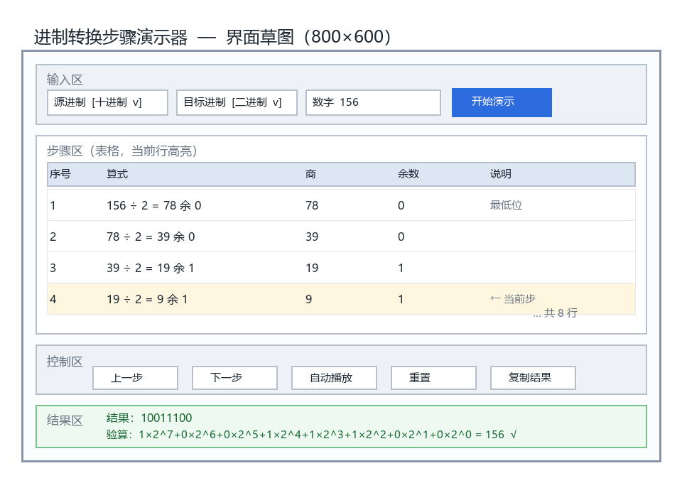

# 项目需求与设计文档

**项目名称**：进制转换步骤演示器（Base Converter Step Visualizer）
**课程**：计算机科学导论
**团队**：第 X 组（4 人）
**版本**：v0.1（提交审核稿）
**日期**：2026-11-27

---

## 一、项目背景与目标

### 1.1 背景

进位制转换是计算机导论课程的基础内容。课堂教学以板书推导为主，学生在课后练习时常常出现两类问题：

1. **记不住步骤**：知道「除 2 取余」，但不知道余数为什么要倒序排列；
2. **算完不会验算**：结果写出来了，却无法判断对错。

现有工具（计算器、在线转换网站）只给结果，**不展示过程**，无法承担“教学演示”的作用。

### 1.2 目标

开发一个**桌面可视化演示程序**，把进位制转换的中间步骤完整暴露出来，达成三个具体目标：

- **可看**：每一步的除法算式、余数、当前位权以表格形式逐行呈现；
- **可控**：支持单步前进/后退，教师可配合讲解节奏；
- **可验**：转换完成后自动按位权展开验算，结果对错一目了然。

### 1.3 非目标（本期不做）

- 不做浮点数转换（仅处理非负整数）
- 不做联网功能、不做账号系统
- 不做移动端适配

---

## 二、选题与范围

### 2.1 选题依据

选题来自《课程讲义》第一章「数制与编码」，属于课程核心基础概念，具备三个优点：

| 维度 | 说明 |
|---|---|
| 概念典型性 | 进位制是后续补码、浮点表示的前置知识 |
| 可视化可行性 | 步骤是确定性的、可枚举的，适合逐行展示 |
| 工作量适中 | 核心算法约 100 行，界面 2 个页面，4 人可在 3 周内完成 |

### 2.2 功能范围

**本期实现（Must have）**

1. 十进制 → 二进制 / 八进制 / 十六进制
2. 二进制 / 八进制 / 十六进制 → 十进制
3. 步骤表格：序号、算式、商、余数、说明
4. 单步前进/后退/自动播放
5. 结果验算与错误提示

**可选实现（Nice to have）**

6. 任意进制互转（2–16）
7. 步骤文本一键复制
8. 深色/浅色主题切换

**不做（Out of scope）**

- 小数转换
- 负数与补码（留作后续扩展）

---

## 三、用户与使用场景

### 3.1 目标用户

| 用户 | 场景 | 需求 |
|---|---|---|
| 学生 | 课后做题卡住时 | 看一遍完整步骤，对照自己的算法 |
| 教师 | 课堂演示 | 单步控制，配合讲解节奏 |
| 助教 | 批改作业 | 快速验证学生答案的过程是否规范 |

### 3.2 典型使用流程

1. 打开程序 → 默认显示「十进制 → 二进制」界面
2. 输入 `156`，选择目标进制 `2`
3. 点击「开始演示」→ 表格逐行出现：
   `156 ÷ 2 = 78 余 0`
   `78 ÷ 2 = 39 余 0`
   `...`
4. 点击「下一步」逐步推进，或「自动播放」连续演示
5. 结束后展示结果 `10011100`，并给出验算：
   `1×2⁷ + 0×2⁶ + 0×2⁵ + 1×2⁴ + 1×2³ + 1×2² + 0×2¹ + 0×2⁰ = 156 ✓`

---

## 四、界面与交互设计

### 4.1 界面草图



> 说明：草图用纸笔或 draw.io 绘制，导出 PNG 放入 `docs/images/`。**提交审核前必须替换为真实图片**（作业要求至少一张参考图片）。

### 4.2 布局说明

| 区域 | 内容 | 交互 |
|---|---|---|
| 顶部输入区 | 源进制下拉框、目标进制下拉框、数字输入框、开始按钮 | 输入校验，非法字符实时标红 |
| 中部步骤区 | 步骤表格（序号/算式/商/余数/说明），当前行高亮 | 随单步操作滚动定位 |
| 底部控制区 | 上一步、下一步、自动播放、重置、复制结果 | 首尾步骤按钮置灰 |
| 结果区 | 最终结果 + 验算式 + 对错标记 | 成功绿色、失败红色 |

### 4.3 关键交互规则

- 输入为空或含非法字符 → 「开始演示」按钮置灰，输入框下方给出提示
- 转换结束 → 自动定位到最后一行，结果区高亮
- 自动播放间隔 800ms，可随时暂停
- 切换进制时清空上一步结果，避免混淆

---

## 五、技术方案

### 5.1 技术选型

| 层面 | 选择 | 理由 |
|---|---|---|
| 语言 | Python 3.10+ | 课程要求，生态成熟，AI 生成质量高 |
| GUI | Tkinter | 标准库自带，零安装成本，适合教学场景 |
| 版本控制 | Git + GitHub | 课程要求，支持 PR 与冲突演示 |
| AI 辅助 | DeepSeek / Cursor | 生成界面骨架与算法实现 |

### 5.2 模块划分

```
┌─────────────────────────────────────┐
│  ui/main_window.py   主窗口与布局    │
│  ui/widgets.py       步骤表格控件    │
└──────────────┬──────────────────────┘
               │ 调用（只传数据，不写业务逻辑）
┌──────────────▼──────────────────────┐
│  core/converter.py   转换算法        │  ← 纯函数，可单独测试
│  core/steps.py       步骤文本生成    │
└─────────────────────────────────────┘
```

**设计原则**：界面层只负责显示与事件转发，所有计算逻辑集中在 `core/`，保证核心算法可以脱离界面单元测试。

### 5.3 核心算法

**十进制 → 任意进制（除基取余法）**

```
输入：n（十进制整数）, base（目标进制）
steps = []
while n > 0:
    q, r = divmod(n, base)
    steps.append((n, q, r))
    n = q
结果 = 将 steps 中的余数逆序拼接（10 以上用 A-F 表示）
```

**任意进制 → 十进制（按位权展开）**

```
结果 = Σ (d_i × base^i)，i 从 0 开始，自右向左
```

### 5.4 数据结构

```python
# 单步记录
step = {
    "index": 1,          # 步序
    "dividend": 156,     # 被除数
    "divisor": 2,        # 基数
    "quotient": 78,      # 商
    "remainder": 0,      # 余数
    "note": "156 ÷ 2 = 78 余 0，最低位为 0",
}
```

---

## 六、团队分工与里程碑

### 6.1 分工表

| 成员 | 角色 | 具体任务 | 交付物 |
|---|---|---|---|
| 梁钊源 | 文档主笔 / 集成 | 建仓、分支保护、PR 审核、冲突解决、最终合并、演示主讲、需求文档主笔 | 仓库、全部合并记录、需求文档 |
| 孙依晨 | 核心算法 | `core/converter.py`、`core/steps.py` + 单元测试 | 转换算法、步骤生成、测试用例 |
| 姜邵峰 | 界面开发 | `ui/main_window.py`、`ui/widgets.py`、界面联调 | 可交互界面、运行截图 |
| 余浩源 | 文档与验证 | `README.md`、`AI_Prompts_Log.md`、验收测试、演示 PPT | README、AI 记录、测试报告、演示材料 |

### 6.2 里程碑

| 阶段 | 时间 | 产出 | 验收标准 |
|---|---|---|---|
| M1 需求评审 | 第 1 周 | 本文档 | 教师审核通过 |
| M2 核心算法 | 第 2 周 | `core/` 完成 + 测试通过 | 命令行可演示全部转换 |
| M3 界面集成 | 第 3 周 | `ui/` 完成 | 图形界面可完整走通一次转换 |
| M4 冲突演练 | 第 3 周末 | 冲突解决记录 | 至少一次真实合并冲突 |
| M5 交付 | 第 4 周 | README + 截图 + 演示 | 课堂演示无卡顿 |

### 6.3 协作规范

- 分支命名：`feature/converter`、`feature/ui`、`docs/requirements`
- 提交信息：`feat: 实现十进制转二进制`、`fix: 修复余数倒序错误`、`docs: 补充界面草图`
- 每个 PR 至少 1 人 Review 后才能合并

---

## 七、风险与应对

| 风险 | 影响 | 概率 | 应对 |
|---|---|---|---|
| AI 生成的界面代码跑不起来 | 进度延误 | 高 | 先用命令行验证算法，再接入界面；保留每轮可运行版本 |
| Tkinter 表格控件不会用 | 界面卡住 | 中 | 用 `ttk.Treeview` 替代手写表格，先做静态展示 |
| 合并冲突处理不当丢代码 | 数据丢失 | 中 | 合并前先 `git pull`，冲突时双方一起看 |
| 选题被驳回 | 整体返工 | 低 | 本文档已覆盖工作量与可行性，预留一天修改时间 |

---

## 八、验收标准

- [ ] 输入 156、目标进制 2，输出 `10011100`，且步骤表行数正确（8 行）
- [ ] 反向转换 10011100 → 156 正确
- [ ] 非法输入（字母、负数、空）有明确提示且不崩溃
- [ ] 单步前进/后退在首尾步骤正确置灰按钮
- [ ] 验算结果与实际一致
- [ ] 程序在纯净环境（只装 Python）可运行

---

## 九、参考资料

1. 《计算机科学导论》课程讲义，第一章「数制与编码」
2. Python 官方文档 — Tkinter：https://docs.python.org/zh-cn/3/library/tkinter.html
3. 补码与进制转换参考：https://docs.github.com/zh
