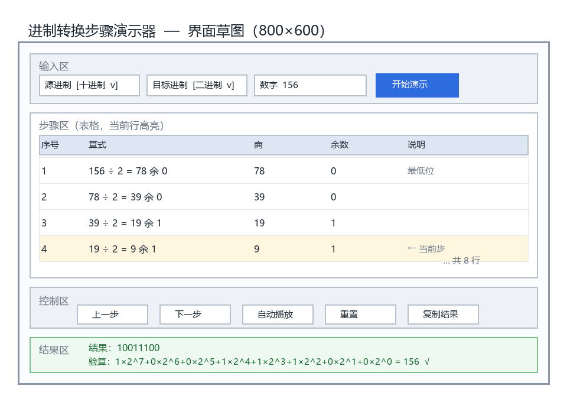

# 进制转换步骤演示器

> 计算机导论课程大作业 · 小组项目
>
> 用一个桌面小程序，把「十进制 ↔ 二进制 ↔ 十六进制」的转换过程**一步一步**演示出来，让初学者看清每一次「除以基数、取余数、倒序排列」到底发生了什么。

---

## 项目简介

进位制转换是计算机导论课的第一个抽象概念：老师在黑板上写一遍「156 ÷ 2 = 78 余 0……」，学生抄下来却不知道这些余数为什么要倒着排。

本项目做一个可视化演示程序：用户输入一个数和目标进制，程序**逐行**显示每一步的除法和余数，并把最终结果按位权展开验算一遍。目标是让“看得见的步骤”替代“背下来的公式”。

---

## 功能特性

- **十进制 → 任意进制**：逐步显示「除以基数 → 取余 → 商继续除」，最后倒序拼接
- **任意进制 → 十进制**：按位权展开，逐项显示 `1×2³ + 0×2² + 0×2¹ + 1×2⁰`
- **2–16 进制互转**：支持二进制、八进制、十六进制及自定义进制
- **单步控制**：上一步 / 下一步 / 自动播放，当前步骤高亮
- **结果校验**：自动验算，错误时提示
- **一键复制**：复制完整步骤文本，方便粘贴到作业里

---

## 运行环境

| 项目 | 要求 |
|---|---|
| 语言 | Python 3.10 及以上 |
| GUI 库 | Tkinter（Python 标准库自带，**无需 pip 安装**） |
| 操作系统 | Windows 10/11、macOS、Linux |
| 依赖 | 无第三方依赖 |

---

## 安装与运行

```bash
# 1. 克隆仓库
git clone https://github.com/你的用户名/cs-intro-viz.git

# 2. 进入目录
cd cs-intro-viz

# 3. 运行
python main.py
```

> Windows 上如果 `python` 不识别，改用 `py main.py`。

---

## 项目结构

```
cs-intro-viz/
├── main.py                     # 程序入口
├── ui/
│   ├── main_window.py          # 主窗口与布局
│   └── widgets.py              # 步骤表格、按钮等自定义控件
├── core/
│   ├── converter.py            # 进制转换核心算法（纯逻辑，不依赖界面）
│   └── steps.py                # 生成每一步的解释文本
├── docs/
│   ├── Project_Requirements_and_Design.md
│   └── images/
│       └── screenshot-main.png # 界面截图（用后替换成真实截图）
├── AI_Prompts_Log.md           # AI 结对编程记录
├── .gitignore
├── LICENSE
└── README.md
```

---

## 界面预览



> 当前为**界面草图**（开发阶段）。程序完成后请替换为真实运行截图：运行程序后按 `Win + Shift + S` 框选窗口，保存到 `docs/images/screenshot-main.png`。

---

## 团队分工

| 姓名 | 学号 | 负责模块 | GitHub 用户名 |
|---|---|---|---|
| 梁钊源（组长） | 2026xxxx | 需求文档主笔、仓库管理、PR 审核、集成与演示主讲 | @nekodoorl |
| 孙依晨 | 2026xxxx | 核心算法 `core/converter.py`、`core/steps.py` 与单元测试 | @member-b |
| 姜邵峰 | 2026xxxx | 界面 `ui/main_window.py`、`ui/widgets.py` 与运行截图 | @member-c |
| 余浩源 | 2026xxxx | `README.md`、`AI_Prompts_Log.md`、演示 PPT 与验收测试 | @member-d |

---

## 开发流程

- `main` 分支为受保护分支，**禁止直接推送**
- 每人从 `main` 拉出自己的功能分支：`feature/xxx`
- 完成后推送并发起 **Pull Request**，由组长 Code Review 后合并
- 至少一次合并冲突需要手动解决并记录

---

## 开源协议

本项目采用 [MIT License](LICENSE) 开源协议。

---

## 贡献者

感谢以下同学参与开发（按贡献排序）：

- 梁钊源 —— 项目管理、需求文档、集成与演示
- 孙依晨 —— 核心算法与单元测试
- 姜邵峰 —— 界面实现与联调
- 余浩源 —— README、AI 记录、测试与 PPT


